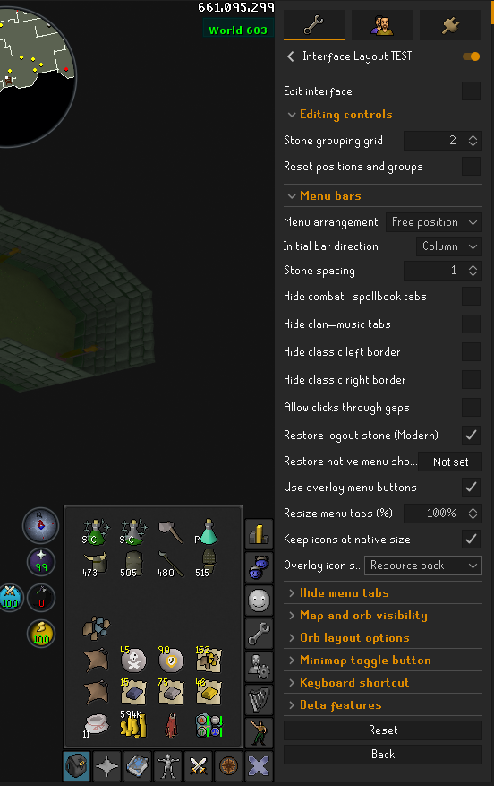
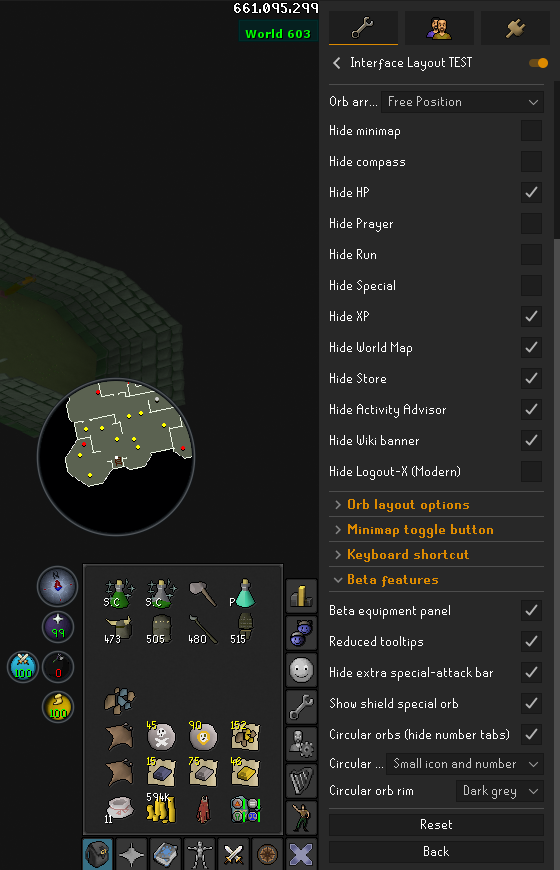

# Interface Layout

Arrange RuneLite around the way you play. Move menu bars, detach tabs into rows or columns, position orbs and the compass, and choose which controls stay visible. Scale overlay menu buttons while keeping your resource-pack icons.

## What you can do

- **Build menu layouts:** keep native rows, start with vertical bars, or create custom groups and detached buttons.
- **Scale overlay buttons:** adjust all menu buttons together from **25–200%**.
- **Keep your artwork:** **Resource pack** is the default icon source, including custom spellbooks. **Faithful contours** is an optional style and a fallback for missing pack replacements.
- **Position map controls:** move and anchor the native minimap, free orbs and compass in resizable modes.
- **Use circular rims:** Silver or Dark grey frames, or no custom rim, with optional number-only, icon-only or combined circular-orb contents.
- **Track orb timers:** Optional inner rings for HP regeneration, special energy and prayer drain, including Rapid Heal, Lightbearer and equipment prayer bonus. The outer prayer potion-dose reminder stays separate.
- **Save each display mode:** Fixed, Resizable Classic and Resizable Modern keep separate menu layouts.
- **Control visibility:** hide individual tabs, map controls and decorative borders, with shortcuts and resets.

## Getting started

1. Enable **Interface Layout**, then open its minimap icon in RuneLite's side panel. If hidden, enable **Show side panel icon** in the regular plugin settings.
2. In **Orbs**, choose **Normal**, **Free placement** or **Compact orbs**. Normal restores native positioning without deleting your free layout.
3. In **Menu Tabs**, choose the arrangement, overlay buttons, artwork and size. Expand **Visible menu tabs** to show or hide individual buttons.
4. In **Orbs**, expand a control such as **Prayer** to adjust its visibility, mirroring and Beta timer together. Related settings appear when enabled.
5. In **Anchors**, create containers or import Custom UI Anchors. Enable **Edit anchors**, then hold your RuneLite drag hotkey and drop supported controls into a highlighted anchor. Ctrl-click or Shift-click member names to move or detach a selection together.
6. **General** contains interface editing, equipment options, borders and resets. Enable **Edit interface** for menu grouping; Alt-drag moves controls, and Shift-drag groups menu tabs. Turn editing off when finished.

Regular plugin settings retain editing, keyboard shortcuts and sidebar visibility. Existing settings and saved layouts are preserved. Screenshots and recordings below show the earlier settings arrangement; use these tab names for the current controls.

## Resource packs and Faithful contours

**Menu Tabs → Icon artwork → Resource pack** follows active Resource Packs and Interface Styles replacements, including your spellbooks. Missing replacements fall back to Faithful contours. Selecting **Faithful contours** uses the bundled artwork instead; active tab backgrounds still follow the current game or pack.

**Keep native icon size** keeps icons at normal size inside enlarged buttons. Below 100%, they shrink with the buttons. Packs must support the selected display mode. No resource pack is downloaded or redistributed by this plugin.

Native and overlay menu layouts are saved separately. Turning overlay buttons off restores the saved native layout.

Overlay menu buttons and icon-source settings

Example from a local TEST build with Resource pack selected. The displayed artwork depends on the active pack.

## Free-position native minimap

In **Classic or Modern resizable**, choose **Orbs → Positioning → Free placement** and leave **Orbs → Minimap & compass → Show minimap** checked. Alt-drag the native minimap, or place it through **Custom UI Anchors** using the normal overlay placement system.

[Watch the 26-second demonstration](docs/media/free-minimap-and-orb-controls.mp4): circular-orb display choices, visibility toggles and native-minimap movement with anchor guides. Recorded in a local TEST build; the documentation copy has no audio.

The native map keeps its content and navigation. Choose **Orbs → Minimap & compass → Frame** to keep the **Native / resource pack** surround (the default), or use the selected **Shared circular rim**. Choose **None** for the rim to remove the custom border. The native surround moves with the map and retains its combined compass socket. The compass follows the map until moved independently; other orbs keep their own positions. The minimap frame does not require enabling circular-orb number-tab removal.

Hiding and showing the map retains its position. Resetting the element clears its custom position. Resetting the layout or disabling the plugin restores native layout behavior. Fixed mode retains its native constraints, and game-hidden controls remain hidden.

**Orbs → Legacy separate minimap → Show separate minimap** is a different option available in Compact orbs while the native map is hidden. That separate map does not include other plugins’ minimap overlays; this limitation is not a reason to replace the visible native map in the new Free Position workflow.

## Built-in anchors

The **Anchors** tab stores containers and their members in Interface Layout. Importing Custom UI Anchors previews the transfer and leaves that plugin's settings unchanged. Avoid assigning the same overlay to both systems at once.

Drag-to-attach works with Edit anchors enabled and your configured RuneLite drag hotkey. Free containers retain the drop offset; Row, Column and Wrap containers use member order. Dropping outside cancels. **Detach** removes an assignment; **Undo** restores the previous edit. Hidden members retain their assignments.

With **Edit anchors** enabled, drag ordinary movable overlays or infobox groups straight into an anchor using your RuneLite drag hotkey. No selection under **Other overlays…** is required; that picker also lets you include overlays in the member list when editing is off. Their original placement is restored when detached. World/actor overlays, tooltips, manually rendered overlays, ambiguous names and plugins that continually reposition themselves are not guaranteed compatible. Our supported menu groups, free map controls, Chat overlays, customized bank and Looting notifications use dedicated adapters.

## Movement, anchors and resets

| Control | Action |
| --- | --- |
| Alt-drag | Move a whole bar, detached tab or supported free-position control. |
| Shift-drag with Edit interface | Detach or join a stone in a custom menu arrangement. |
| Shift-right-click a stone | Return it to its main group. |
| Alt-right-click | Open RuneLite’s overlay reset controls for the element. |
| Reset positions and groups | Reset saved positions/groups after confirmation; retain visibility choices. |

If you changed RuneLite’s overlay movement hotkey, use that modifier instead of Alt. Free-position overlays work with Custom UI Anchors. Ordinary inventory interaction remains protected; orb and minimap click protection is always active, and allowing clicks through gaps between menu tabs does not turn inventory items into click-through space.

Free-position controls and menu groups follow their saved screen edge or center when the game canvas changes size. Explicit RuneLite origins and Custom UI Anchors keep controlling attached elements. Controls are kept within the available canvas; returning to the larger size restores their placement without saving the temporary clamped position. Changing monitors alone does not move the layout if the game canvas stays the same size. Existing absolute layouts learn their reference size when first loaded within the visible canvas, so open the update at your usual size before moving to a smaller display.

## Beta appearance and timers

**Orbs → Orb appearance** offers **Number tabs** or **Circles only**. **Orbs → Special attack** contains the optional shield special orb and extra special-attack meter. The extra meter sits below the special orb in Circles only, separated from its timer. **General → Equipment** contains the optional enhanced equipment panel and reduced tooltips; native equipment slots and the expanded equipment window remain unchanged.

Under **Orbs → Hitpoints / Prayer / Special attack**, choose **Inset sweep**, **Tag meters**, **Quiet rims** or **Eight slices** independently for HP, Prayer and Special. All four styles work with Number tabs and Circles only. HP and Special show regeneration progress. Prayer's countdown empties counterclockwise toward the next point drained, follows active prayers and equipped prayer bonus, and stops when prayers are inactive.

Prayer **Tag meters** and **Eight slices** can display the actual remaining prayer amount, the next-point drain countdown, or both. The blue inset and native prayer symbol stay visible. Existing circular prayer rings retain their appearance until a different style is selected. Native low-prayer flashes and existing potion-dose reminders retain their settings. Timers do not require Regeneration Meter; timing is estimated, especially when enabling mid-session or rapidly changing prayers.

## Guide, compatibility and support

See the [full guide](docs/guide.md) for presets, individual visibility controls, equipment limitations, anchors and conflicting layout plugins. The guide retains an [example movement recording](docs/media/move-detach-reattach.mp4) from a local TEST build; it demonstrates menu grouping, not the new native-minimap movement.

[Report an issue or suggest a feature](https://github.com/wukuna/interface-layout/issues). Include the display mode, native/overlay menu setting, resource pack, anchor setup and affected control.

## License and attribution

See [LICENSE](LICENSE) and the [full attribution](docs/guide.md#license-and-attribution). Existing code and third-party notices are retained.
