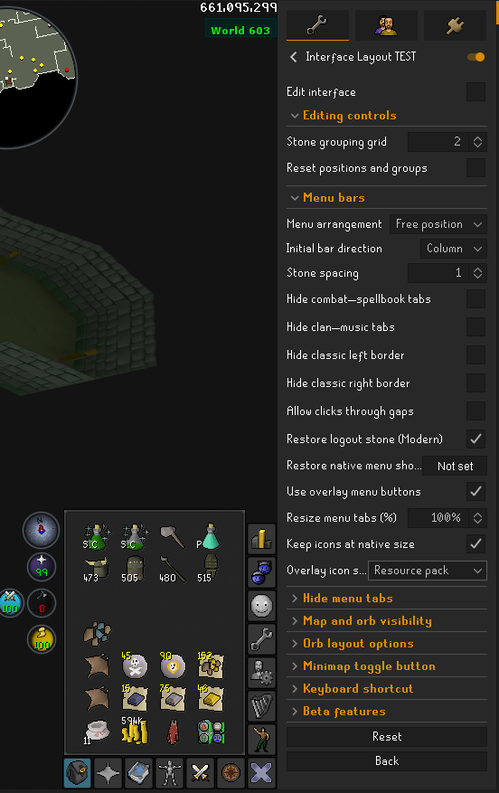
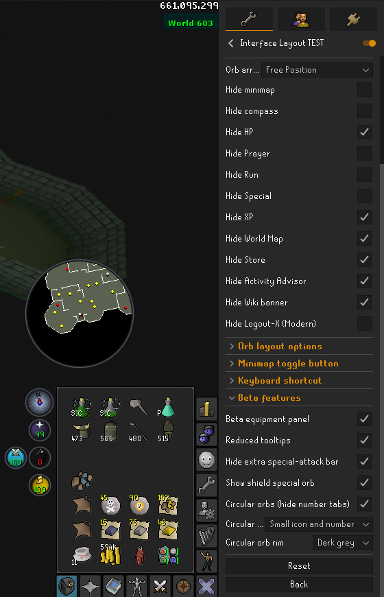

# Interface Layout

Arrange RuneLite around the way you play. Move menu bars, detach tabs into rows or columns, position orbs and the compass, and choose which controls stay visible. Scale overlay menu buttons while keeping your resource-pack icons.

**Pending Hub update:** frame choices and always-on orb/minimap click protection are included in [the submitted update](https://github.com/runelite/plugin-hub/pull/20615).

## What you can do

- **Build menu layouts:** keep native rows, start with vertical bars, or create custom groups and detached buttons.
- **Scale overlay buttons:** adjust all menu buttons together from **25–200%**.
- **Keep your artwork:** **Resource pack** is the default icon source, including custom spellbooks. **Faithful contours** is an optional style and a fallback for missing pack replacements.
- **Position map controls:** move and anchor the native minimap, free orbs and compass in resizable modes.
- **Use circular rims:** Silver or Dark grey frames, or no custom rim, with optional number-only, icon-only or combined circular-orb contents.
- **Track orb timers:** Optional inner rings for HP regeneration, special energy and prayer drain, including Rapid Heal, Lightbearer and equipment prayer bonus. The outer prayer potion-dose reminder stays separate.
- **Save each display mode:** Fixed, Resizable Classic and Resizable Modern keep separate menu layouts.
- **Control visibility:** hide individual tabs, map controls and decorative borders, with shortcuts and resets.

## Getting started

1. Install **Interface Layout** from RuneLite’s Plugin Hub and open its settings.
2. Choose a **Menu arrangement** under **Menu bars**, then enable **Edit interface** for grouping guides.
3. **Alt-drag** moves whole bars or controls. **Shift-drag** detaches or joins a menu stone when custom grouping is enabled.
4. To scale buttons, enable **Menu bars → Use overlay menu buttons** and set **Resize menu tabs (%)**.
5. For individually movable map controls, choose **Map and orb visibility → Orb arrangement → Free Position** in a resizable display mode.
6. Turn **Edit interface** off when finished. Saved positions remain.

## Resource packs and Faithful contours

**Menu bars → Overlay icon style → Resource pack** follows active Resource Packs and Interface Styles replacements, including your spellbooks. Missing replacements fall back to Faithful contours. Selecting **Faithful contours** uses the bundled artwork instead; active tab backgrounds still follow the current game or pack.

**Keep icons at native size** keeps icons at normal size inside enlarged buttons. Below 100%, they shrink with the buttons. Packs must support the selected display mode. No resource pack is downloaded or redistributed by this plugin.

Native and overlay menu layouts are saved separately. Turning overlay buttons off restores the saved native layout.

Overlay menu buttons and icon-source settings

Example from a local TEST build with Resource pack selected. The displayed artwork depends on the active pack.

## Free-position native minimap

The frame choices below are part of the pending update.

In **Classic or Modern resizable**, choose **Free Position** and leave **Hide minimap** off. Alt-drag the native minimap, or place it through **Custom UI Anchors** using the normal overlay placement system.

[Watch the 26-second demonstration](docs/media/free-minimap-and-orb-controls.mp4): circular-orb display choices, visibility toggles and native-minimap movement with anchor guides. Recorded in a local TEST build; the documentation copy has no audio.

The native map keeps its content and navigation. Choose **Map and orb visibility → Free minimap frame** to keep the **Native / resource pack** surround (the default), or use the selected **Circular orb rim**. Choose **None** for the rim to remove the custom border. The native surround moves with the map and retains its combined compass socket. The compass follows the map until moved independently; other orbs keep their own positions. The minimap frame does not require enabling circular-orb number-tab removal.

Hiding and showing the map retains its position. Resetting the element clears its custom position. Resetting the layout or disabling the plugin restores native layout behavior. Fixed mode retains its native constraints, and game-hidden controls remain hidden.

**Show separate minimap** is an existing, different option used while the native map is hidden. That separate map does not include other plugins’ minimap overlays; this limitation is not a reason to replace the visible native map in the new Free Position workflow.

## Movement, anchors and resets

| Control | Action |
| --- | --- |
| Alt-drag | Move a whole bar, detached tab or supported free-position control. |
| Shift-drag with Edit interface | Detach or join a stone in a custom menu arrangement. |
| Shift-right-click a stone | Return it to its main group. |
| Alt-right-click | Open RuneLite’s overlay reset controls for the element. |
| Reset positions and groups | Reset saved positions/groups after confirmation; retain visibility choices. |

If you changed RuneLite’s overlay movement hotkey, use that modifier instead of Alt. Free-position overlays work with Custom UI Anchors. Ordinary inventory interaction remains protected; settings for clicks through map areas or gaps between menu stones do not turn inventory items into click-through space.

Free-position controls and menu groups follow their saved screen edge or center when the game canvas changes size. Explicit RuneLite origins and Custom UI Anchors keep controlling attached elements. Controls are kept within the available canvas; returning to the larger size restores their placement without saving the temporary clamped position. Changing monitors alone does not move the layout if the game canvas stays the same size. Existing absolute layouts learn their reference size when first loaded within the visible canvas, so open the update at your usual size before moving to a smaller display.

## Beta appearance features

**Beta features** contains circular-orb presentation, the supported shield special orb and equipment presentation controls. The current **Beta equipment panel** adds compact bonuses, weight and spellbook information to the in-game Equipment tab. It is separate from RuneLite’s toolbar side panel and does not change the expanded equipment window.

With circular orbs enabled, **HP regeneration ring**, **Special regeneration ring** and **Prayer drain ring** can be toggled independently. These timers work without enabling Regeneration Meter. The prayer ring starts full and empties counterclockwise toward the next point drained, adjusts to active prayers and equipped prayer bonus, and disappears when prayers are inactive. Potion restoration does not restart the drain estimate. RuneLite’s outer flashing potion-dose reminder and separate Prayer Regeneration Helper reminders retain their own settings. Timing is estimated, especially when enabling the plugin mid-session or rapidly switching prayers.

## Guide, compatibility and support

See the [full guide](docs/guide.md) for presets, individual visibility controls, equipment limitations, anchors and conflicting layout plugins. The guide retains an [example movement recording](docs/media/move-detach-reattach.mp4) from a local TEST build; it demonstrates menu grouping, not the new native-minimap movement.

[Report an issue or suggest a feature](https://github.com/wukuna/interface-layout/issues). Include the display mode, native/overlay menu setting, resource pack, anchor setup and affected control.

## License and attribution

See [LICENSE](LICENSE) and the [full attribution](docs/guide.md#license-and-attribution). Existing code and third-party notices are retained.
