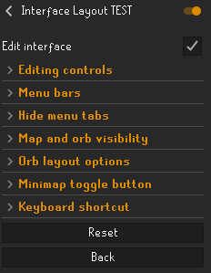
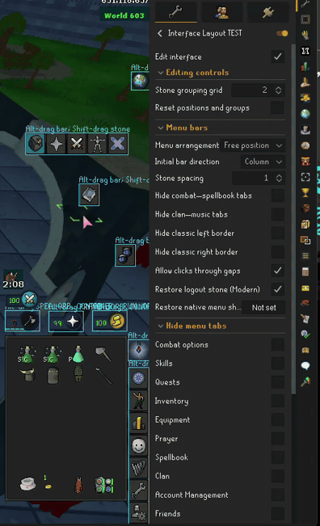
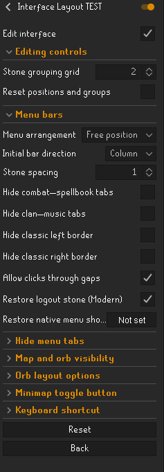
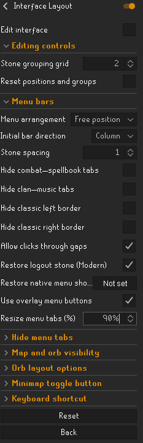
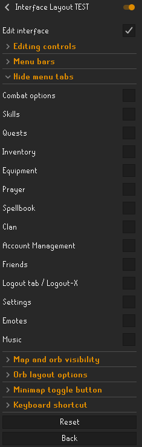
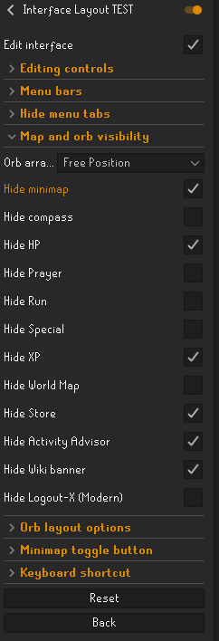
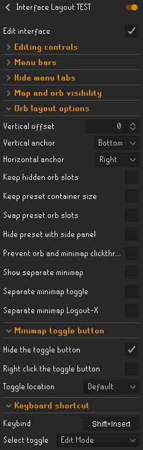

# Interface Layout

Arrange RuneLite around the way you play. Move orbs and the compass, detach menu tabs and reconnect them into custom rows or columns, or choose a compact preset. Resize overlay menu buttons together from **25–200%**, keeping your active game or resource-pack artwork in **Fixed, Resizable Classic and Resizable Modern**. Control which elements remain visible, restore the Modern logout stone, and protect orb and minimap clicks from reaching the game behind them. Overlay buttons are optional and start off.

[Features](#features) · [Getting started](#getting-started) · [Usage](#usage) · [Saved settings](#saved-settings) · [Compatibility](#compatibility) · [Inspiration and recipe](#inspiration-and-recipe) · [Development](#development) · [Support](#support) · [License and attribution](#license-and-attribution)

## Features

- **Free-position orbs** — move individual orbs and the compass independently of the minimap in resizable modes.
- **Compact orb layouts** — arrange orbs vertically, horizontally, in a wider row, or with a custom preset.
- **Movable menu bars** — keep native rows or start with vertical bars, then drag each bar wherever you want.
- **Optional overlay menu buttons** — adjust menu-tab buttons from 25–200% together with one shared size setting, using the active game or resource-pack artwork. Native and overlay layouts are remembered separately. Off by default.
- **Individual menu stones** — detach stones, leave them on their own, or join them into separate rows and columns.
- **Individual visibility** — hide orbs, the compass, the minimap or specific menu tabs. Hidden menu stones also lose their backgrounds, and the remaining stones close the gap.
- **Saved layouts** — keep separate menu arrangements for Fixed, Resizable Classic and Resizable Modern.
- **Editing controls** — use drag handles, optional grid snapping and resets to adjust your layout.
- **Modern logout stone** — optionally give the existing logout X a stone background; both forms can join custom menu bars. Fixed and Classic keep their normal logout tabs.
- **Shield special orb** — optionally show a separate, movable shield-charge orb under Presentation, using the game's existing off-hand special-attack action. Off by default.
- **Shortcuts and protection** — toggle editing or minimap visibility, restore the native menu temporarily, and choose whether clicks pass through gaps between stones.

## Getting started

1. Choose your game display mode, then open **Interface Layout** settings.
2. Pick an orb arrangement and a menu arrangement. Enable **Edit interface** for editing guides.
3. **Alt-drag** moves a whole control or bar. **Shift-drag** detaches or joins menu stones when custom grouping is enabled.
4. To resize the menu buttons together, open **Menu bars**, enable **Use overlay menu buttons**, and adjust **Resize menu tabs (%)**. Leave it at **100%** for native-size buttons.
5. Turn off **Edit interface** when finished. Layouts remain saved separately for Fixed, Classic and Modern. Turn overlay buttons off to return to your saved native menu layout.

The movement video and older settings captures were supplied on 23 October 2026. Their **TEST** suffix identifies the local demonstration build; install **Interface Layout** from the Plugin Hub. The resizing settings capture below was supplied on 28 October and shows the newer overlay-button controls. Checked visibility controls hide their named element. All captures show example setups, not the default settings. Other overlays visible in the recording are not Interface Layout features.

## Usage

### Moving menu stones and orbs

Enable **Edit interface** to show editing outlines and allow **Shift-drag** stone grouping. RuneLite **Alt-drag** moves whole bars, detached stones, free orbs and the compass with Edit interface on or off. Choose **Free Position** under **Map and orb visibility → Orb arrangement** to move orbs individually, and choose a vertical or free-position menu arrangement to detach and regroup stones.

> Move, detach and reattach: the new recording shows individual stones leaving a menu bar and joining it again, alongside independently positioned orbs.

[Watch or download the full-resolution 18-second video](docs/media/move-detach-reattach.mp4?raw=true). The preview loops; the video can be paused. Audio was removed from the documentation copy.

### Menu bars and stone groups

Open **Menu bars** and choose a **Menu arrangement**:

- **Native rows** keeps the game's row arrangement. The rows remain movable, including when individual tabs are hidden.
- **Vertical left** and **Vertical right** start the bars along the selected edge. These are starting positions; you can move the bars afterward.
- **Free position** lets you build your own arrangement. **Initial bar direction** chooses the starting direction of new bars; existing groups keep their direction.

In Fixed and both resizable modes, **Free position** starts with separate top and bottom groups. Older combined defaults are split too, including moved bars; explicitly saved custom memberships, detached groups and ordering are retained. Choosing Column starts the default groups beside each other. In Resizable Classic, an untouched **Native rows** layout keeps the game's original stone artwork, spacing and icon alignment. Moving a native row with zero spacing translates it as a whole.

#### Optional overlay menu buttons

Under **Menu bars**, enable **Use overlay menu buttons**, then choose **Resize menu tabs (%)** (25–200%; 100% follows the native tab size). The setting is off by default. It supports **Fixed**, **Resizable Classic** and **Resizable Modern** and uses the same grouping, hiding controls and drag gestures as native buttons. First use copies the current arrangement into a separate overlay layout for that display mode.

The screenshot shows an example at **90%**. One percentage applies to all overlay menu buttons, including custom bars and detached buttons. It does not give each tab a different size.

The replacements retain the active tab artwork, including Resource Packs and Interface Styles sprite overrides, with a subtle gold hover outline. Changing or disabling a resource pack refreshes the artwork without importing files or changing that plugin's settings. Fixed and Classic use their own row artwork; Modern uses its native stone background. Packs are not bundled and must support the selected display mode.

Clicking a replacement opens the corresponding native tab. Existing native tab options and RuneLite-registered widget options remain on right-click. This changes the replacement menu-tab surfaces only: it does not resize orbs, the inventory contents, prayers, spells or other game interfaces. Native tab widgets retain their original dimensions. Controls hidden by the game remain unavailable, and supported overlapping windows take priority.

The shared size setting applies the same percentage to every replacement menu button, including detached buttons and custom bars. There are no individual tab-size controls. Existing `menuGroupSize` preferences are retained; old per-tab test preferences are ignored. Sizing only runs with overlay buttons enabled.

Native and overlay menu positions/groups are stored separately for each display mode. Menu arrangement, spacing and tab visibility are remembered separately for the two button types. Turn overlays off to restore the previous native setup; turn them on again to return to your overlay setup. The snapshots belong to the current RuneLite profile and do not change another plugin’s settings. Orb controls remain unchanged. If the current gameframe does not expose a usable native tab operation, or a complete group will not fit the canvas, the native controls are retained. Stretched Mode still handles scaling the entire game view.

**Icon appearance:** enable **Menu bars > Keep icons at native size** to keep icons centred at their normal size inside enlarged buttons. Below 100%, the icons shrink with the buttons; above 100%, only the background and click area grow. The same rule applies to custom bars and detached tabs, and it retains your active resource-pack artwork. This option starts off, preserving the existing appearance where backgrounds and icons scale together. Small pixel-art icons can still look uneven at fractional sizes such as 90%; this option prevents enlargement rather than adding smoothing.

#### Moving a whole bar

Hold **Alt** and drag a menu bar, using RuneLite's normal overlay positioning controls. The same control works with **Edit interface** on or off. If you changed RuneLite's overlay movement hotkey, use that key instead of Alt.

**Stone spacing** sets the gap between visible stones. Hiding a stone closes its gap while keeping the group's saved position.

**Allow clicks through gaps** is enabled by default. Disable it to block clicks through the spacing between visible, clickable stones in a moved bar without selecting a neighboring tab. Overlapping supported game windows take priority. Native menu protection covers supported world actions; unfamiliar menu entries are left available rather than removed. Clicks on the stones, outside the bar, and selections in an already-open right-click menu remain unchanged.

#### Moving a single stone

Choose **Free position**, **Vertical left** or **Vertical right** first. Individual stone groups are not available in **Native rows**.

1. Enable **Edit interface**, then hold **Shift** and drag a stone away from its bar. Use Shift alone; Alt uses RuneLite's whole-bar movement.
2. Release it away from other stones to leave it on its own.
3. Drop it near another stone or group to join them.

Joining an existing bar preserves that bar's direction. Joining two separate stones side by side creates a row; joining them above or below each other creates a column. You can drag the resulting group as a whole or detach a stone again.

**Shift-right-click** a stone to return it to its main group.

Stone grouping has a five-pixel movement threshold and shows a proposed-position outline while dragging. Membership and position are saved only when you release. Focus loss, native interface rebuilds, or display-mode changes cancel the pending edit without changing the saved group. Stretched Mode uses RuneLite's translated native canvas coordinates, so grouping does not depend on which plugin was enabled first. Existing layouts are preserved; there is no separate stretched layout or migration.

### Hide menu tabs

Moved stones temporarily give way to overlapping Bank/PIN, Collection Log, skill-guide and Settings windows. Stones outside those windows stay available. Moving, resizing or closing a supported window restores uncovered stones in their saved positions; the plugin does not move or resize the windows themselves.

This also covers Combat Achievements overview, tasks, boss lists/details and rewards, plus quest journals, achievement-diary task windows, journal scrolls and quest-completion screens. Only visible window areas count; hidden windows and the ordinary quest sidebar do not hide stones.

Banking can hide tab icons as part of the game's normal behavior. Interface Layout preserves stone backgrounds that the game still displays without forcing hidden icons back on or making them clickable. Bank and PIN windows keep their native positions and sizing. Window protection covers the interfaces listed above; it does not promise coverage for every game interface.

Open **Hide menu tabs** to hide individual tabs, including Combat options, Skills, Quests, Inventory, Equipment, Prayer, Spellbook, Clan, Account Management, Friends, Logout, Settings, Emotes and Music.

Hiding a tab removes its icon and stone background. The remaining stones close the gap, and the bar stays movable. Show the tab again by clearing its visibility setting.

The **Menu bars** section also includes broader controls:

- **Hide combat–spellbook tabs** hides the first seven tabs wherever you have placed them.
- **Hide clan–music tabs** hides the second set of tabs wherever you have placed them.
- **Hide classic left border** and **Hide classic right border** remove the decorative borders in Resizable Classic.
- **Restore native menu shortcut** temporarily shows the original menu arrangement and visibility. Press it again to return to your saved layout.

The logout control depends on the game's display mode. **Fixed** and **Resizable Classic** have a Logout tab in the menu row. **Resizable Modern** uses the Logout-X beside the minimap instead.

#### Logout control in Modern

**Restore logout stone (Modern)** places the existing logout X over a menu-stone background. Leave it off for the bare X. Both forms can be detached and joined to custom menu bars; changing the background preserves saved grouping. In Native rows, the bare X stays beside the minimap.

Fixed and Resizable Classic keep their native Logout tabs. **Hide Logout-X (Modern)**, the individual logout visibility setting and **Hide clan–music tabs** can hide the Modern control; check those settings if it is missing. In custom menu arrangements, the logout control belongs to the menu group, so individual orb dragging and the separate minimap logout copy are suspended. Turning restoration off removes only the added background and keeps custom group membership. The X opens the native logout panel; game-hidden controls remain hidden.

### Presentation

Enable **Presentation > Hide extra special-attack bar** to hide the small secondary meter beneath the special-attack orb. This is optional and starts off. The orb's icon, number and normal special-attack controls remain available. Turning the setting off restores the meter when the game would normally show it.

Enable **Presentation > Show shield special orb** for a separate special-attack orb for supported shield-slot equipment, using the game's existing off-hand action. It uses the native shield icon, shows the shield's charges, and follows compatible resource-pack sprite replacements. It starts off and appears only while a supported shield and its native special-attack control are available. The current supported charge system has 20 charges and requires 10 to activate; other shield abilities are not assumed to work the same way.

The shield orb starts beside the regular special-attack orb. Move it with RuneLite's overlay-drag modifier (normally Alt). Clicking it selects **Use Offhand** or **Deactivate Offhand** when both weapon and shield specials are available; when the shield supplies the primary special, it uses that action instead. Keep the native special orb visible. **Hide extra special-attack bar** is a separate choice, so you can hide the small meter while using the new orb. Unequipping the shield removes the extra orb; two-handed weapon stacks do not activate it.

After an update, the chatbox lists up to five recent changes, newest first. Each update notice appears once per RuneLite profile when you are logged in, rather than every login.

### Map and orb visibility

Use **Map and orb visibility** to choose an orb arrangement and hide individual controls.

- **Hide minimap** removes the native minimap in resizable modes. In Free Position, the orbs keep their saved locations.
- **Hide compass** hides the compass independently.
- Individual orb settings hide HP, Prayer, Run, Special, XP and the other available map-side controls.
- **Hide Logout-X (Modern)** hides the minimap's logout control in Resizable Modern.

Showing a free-position orb or the compass again restores its saved location. A control that the game itself does not currently display will not appear just because its hide setting is off.

#### Free-position orbs and compass

Choose **Orb arrangement → Free Position**, then **Alt-drag** an orb or the compass to its own position. Enable **Edit interface** if you want additional outlines and guidance. The compass can move separately from the minimap.

Use RuneLite's **Alt-right-click** to reset an element's position. Disable **Edit interface** or press **Escape** to hide editing guidance when you are finished.

Free Position moves the orbs and compass; it does not move the minimap itself. To put a separate map elsewhere, use **Show separate minimap**, described below.

Moving another orb preserves the native Wiki and world-map button positions, even if you have not moved those buttons. Their positions are only saved when you move them yourself. Game-hidden controls remain hidden.

#### Compact orb arrangements

Choose **Vertical preset**, **Horizontal preset**, **Horizontal-wide preset** or **Custom preset**, then enable **Hide minimap** to activate the compact arrangement.

Open **Orb layout options** to adjust the preset:

- **Vertical anchor**, **Horizontal anchor** and **Vertical offset** control its placement.
- **Keep hidden orb slots** preserves the remaining orbs' slots when another orb is hidden.
- **Keep preset container size** preserves the preset's empty space after hiding orbs.
- **Swap preset orb slots** lets you enable Edit interface and drag HP, Prayer, Run or Special onto another orb to swap their slots.
- **Hide preset with side panel** hides the minimap, compass and orbs when the side panel is hidden in Resizable Modern, including the normal minimap with **Hide minimap** disabled. Reopening the side panel restores their previous visibility. Fixed and Resizable Classic are unchanged.

Preset anchoring, gap handling and slot swapping apply to compact arrangements. Free Position uses each element's saved location.

**Prevent orb and minimap clickthrough** stops clicks on orbs and the minimap from reaching the game behind them. Minimap navigation still works, including the detached minimap in compact layouts. This applies to every orb arrangement and uses the existing clickthrough setting.

### Separate minimap and shortcuts

**Show separate minimap**, under **Orb layout options**, displays a separate movable minimap while **Hide minimap** is enabled in a resizable mode. Use RuneLite's normal **Alt-drag** controls to position it.

This separate minimap does not support other plugins' minimap overlays, such as names, tile markers or lines. Keep the native minimap visible if you need those overlays.

- **Separate minimap toggle** adds a show/hide option to the minimap button.
- **Separate minimap Logout-X** adds a logout control to the separate map in Resizable Modern.

The **Minimap toggle button** section controls the optional eye button, its location and whether it requires a right-click. The **Keyboard shortcut** section lets you select a keybind and the action it controls: the button, native minimap, separate minimap or editing mode.

## Saved settings

**Editing controls** includes:

- **Stone grouping grid** aligns Shift-dragged stones to a grid measured in pixels. Set it to **1** to disable snapping. RuneLite handles snapping for Alt-drag movement.
- **Reset positions and groups** asks for confirmation before clearing saved positions and menu groups in every display mode. Choose No or close the dialog to cancel. Your visibility choices are kept.

Menu positions and groups are saved separately for **Fixed**, **Resizable Classic** and **Resizable Modern**. Independent orb and compass positioning, hiding the native minimap, and the separate minimap are features for resizable modes; Fixed keeps its native gameframe constraints.

Legacy Compact Orbs and Menu Stones Hider settings are imported once per RuneLite profile. The original plugins do not need to remain installed.

## Compatibility

### Other orb, minimap and menu layout plugins

Disable other plugins that move or hide the same controls before using Interface Layout. Declared conflicts include **Compact Orbs**, **Menu Stones Hider**, **Fixed Resizable Hybrid**, **Orb Hider**, **Minimap Hider**, **Movable Orbs** and **Custom Game Tabs**. Custom Game Tabs and Interface Layout both own the menu-tab surfaces; use one at a time.

### Custom UI Anchors

Whole bars, detached stones, free orbs and the compass expose separate RuneLite movement overlays. Custom UI Anchors can capture those overlays using the normal overlay movement control. Use Shift-drag to change stone groups. Hidden controls retain their saved positions, while a newly created group gets a new identity.

### Minimap overlays

Use the native minimap when another plugin needs to draw on it. The separate minimap has the overlay limitation described above.

Ctrl+M while the World Map button is hidden is marked **Beta** in the Hide World Map setting tooltip. This shortcut combination has not been verified in-game; show the button again if the shortcut stops working.

## Inspiration and recipe

Interface Layout builds on Compact Orbs by cue and Menu Stones Hider by Richardant. Their adapted work supplies important parts of the orb and menu-visibility foundation. Interface Layout adds coordinated editing, detachable menu stones and custom bar grouping. Custom Game Tabs by Frederick Campbell provides the reference for replacement tab surfaces and native menu-operation projection; our implementation keeps the existing Interface Layout groups and the active gameframe artwork across all three modes. The wider recipe is compact controls, deliberate placement and a readable gameframe.

| Project | Connection | What it contributes or complements |
| --- | --- | --- |
| [Compact Orbs](https://github.com/its-cue/compact-orbs) | Adapted foundation | Orb arrangements, editing and the separate minimap. Credit to cue; choose one plugin because both manage the same controls. |
| [Menu Stones Hider](https://github.com/Richardant/menustoneshider) | Adapted foundation | Menu-stone and decoration visibility. Credit to Richardant; Interface Layout also moves and groups stones. Declared conflict. |
| [Custom Game Tabs](https://github.com/FrederickCampbell/custom-game-tabs) | Adapted menu-operation approach | Replacement overlay tab buttons and native widget-operation projection. Interface Layout retains its own grouping, uses current resource-pack artwork and supports Fixed, Classic and Modern. Declared conflict. |
| [Orb Hider](https://github.com/wizguin/runelite-orb-hider) | Focused alternative | Orb visibility without the larger layout toolset. Declared conflict. |
| [Movable Orbs](https://github.com/anonyser/runelite-movable-orbs) | Related approach | Positions native orbs around the minimap. Both plugins manage orb placement; declared conflict. |
| [Fixed Resizable Hybrid](https://github.com/Lapask/fixed-resizable-hybrid) | Different layout approach | A Fixed-style gameframe in Resizable Classic. Its reskin is distinct from custom stone grouping. Declared conflict. |
| [Minimap Hider](https://github.com/Richardant/minimaphider) | Focused alternative | Native minimap hiding. Already covered by Interface Layout; declared conflict. |
| [Custom UI Anchors](https://github.com/Car-Role/Custom-UI-Anchors) | Optional companion | Positions and stacks RuneLite overlays, including the movement overlays exposed by Interface Layout. Stone grouping remains in Interface Layout. |
| [Interface Styles (built in)](https://github.com/runelite/runelite/tree/master/runelite-client/src/main/java/net/runelite/client/plugins/interfacestyles) | Optional appearance tool | Classic interface artwork. Styling and control placement are different jobs; check the selected gameframe when combining them. |
| [Resource Packs](https://github.com/melkypie/resource-packs) | Optional appearance tool | Custom UI artwork. Follow its gameframe guidance, including Interface Styles set to Default when required; pack artwork is not bundled here. |
| [Stretched Mode (built in)](https://github.com/runelite/runelite/tree/master/runelite-client/src/main/java/net/runelite/client/plugins/stretchedmode) | Optional display tool | Scales the game view. Interface Layout arranges controls within that view; it does not replace whole-client scaling. |

The separate minimap does not reproduce other plugins' minimap overlays. Keep the native minimap for those drawings. Adapted code, original authors and license terms remain documented in [THIRD_PARTY_NOTICES.md](THIRD_PARTY_NOTICES.md) and the packaged notices.

## Development

Use Java 11 and the repository's Gradle wrapper. Run `./gradlew test build` (Windows: `gradlew.bat test build`). Release commits are selected explicitly in the Plugin Hub manifest; the default branch and the Hub build can differ.

## Support

If a layout does not behave as expected, check for another enabled plugin that moves or hides the same elements. Also check the game display mode and whether you selected a preset or Free Position.

[Open an issue](https://github.com/wukuna/interface-layout/issues) with the affected feature, display mode, steps to reproduce it, relevant settings and any overlapping plugins. A screenshot or short recording helps show positioning problems.

## License and attribution

Interface Layout is distributed under the [BSD-2-Clause license](LICENSE). The license attributes all contributing authors. See [THIRD_PARTY_NOTICES.md](THIRD_PARTY_NOTICES.md) for the original projects and adapted code.
