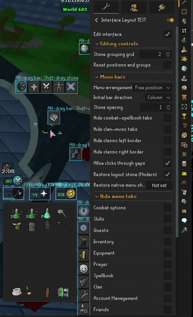
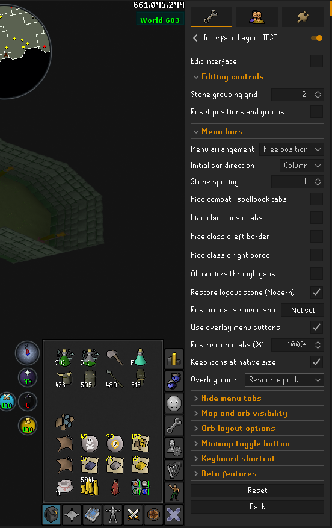
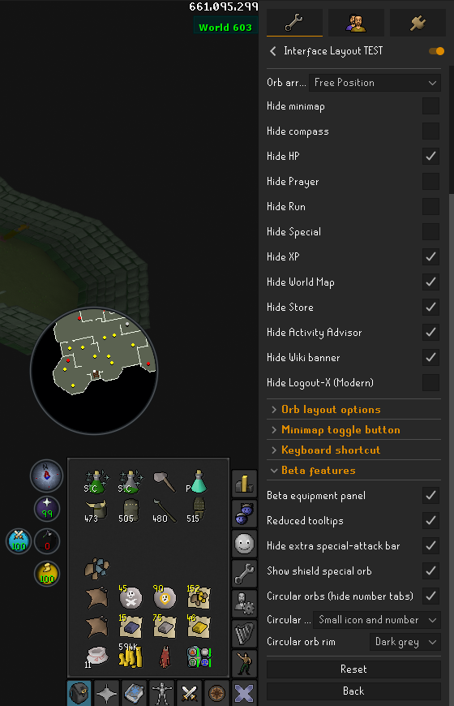

# Interface Layout

Arrange menu tabs, orbs, the compass and minimap around the way you play. Build movable rows or columns, choose what stays visible, and scale overlay menu buttons from **25–200%**. Resource-pack icons are the default; bundled **Faithful contours** are an optional style and fallback. Menu layouts are saved separately for Fixed, Resizable Classic and Resizable Modern.

This guide follows the current source version. See [the Plugin Hub update](https://github.com/runelite/plugin-hub/pull/20665) for availability of the new sidebar and built-in anchors.

[Features](#features) · [Getting started](#getting-started) · [Usage](#usage) · [Saved settings](#saved-settings) · [Compatibility](#compatibility) · [Inspiration and recipe](#inspiration-and-recipe) · [Support](#support) · [License and attribution](#license-and-attribution)

## Current side panel controls

Open Interface Layout's minimap icon in RuneLite's toolbar. **Show side panel icon**, **Edit interface** and keyboard shortcuts remain in regular plugin settings. The editor preserves existing settings and reveals related controls only when relevant.

| Tab | Controls |
| --- | --- |
| Menu Tabs | Arrangement, overlay buttons, artwork, scaling, grouping and individual tab visibility. |
| Orbs | Native/free/compact positioning, minimap and compass frames, individual visibility and mirroring, and per-orb Beta timers. |
| Anchors | Free/Row/Column/Wrap layouts, imports, drag attachment, member order, locking, shared templates and Undo. |
| General | Editing, equipment options, borders and resets. |

**Normal** restores native positioning while retaining the saved free layout. **Free placement** uses the plugin's own anchor points or Custom UI Anchors. For a movable native minimap, select Free placement and keep **Orbs → Minimap & compass → Show minimap** checked. **Orbs → Minimap & compass → Frame → Circular rim** reveals **Shared circular rim**; Native / resource pack retains the attached compass socket even when the compass is moved separately.

Choose **Inset sweep**, **Tag meters**, **Quiet rims** or **Eight slices** independently for each timer with Number tabs or Circles only. Prayer Tag meters and Eight slices support **Amount only**, **Drain only** or **Amount + drain**. Amount tracks actual current/max prayer; the countdown shows the next point drained. The existing circular prayer ring remains the default for existing circular layouts. Native low-prayer flashes and potion-dose reminders are preserved. In Circles only, the extra special-attack meter appears below the orb, clear of its timer; closely packed orbs can clip the extra meter.

The screenshots and recordings below use the earlier settings layout. Menu arrangement, artwork and visibility are now together in Menu Tabs. Minimap and orb settings are together in Orbs, with each orb’s timer and mirror controls in its own section. Anchors has its own tab; General contains equipment, borders, editing and resets. Visibility checkboxes mean shown; older screenshots use inverse Hide checkboxes.

## Features

- **Free-position controls** — move and anchor the native minimap, orbs and compass in resizable modes.
- **Circular orbs** — select **Orbs → Orb appearance → Circles only** to hide the number tabs beside HP, Prayer, Run and Special (including the optional shield orb). Choose number only, icon only, or a small icon and number inside the circle. The button and click-blocking area fit the circle; the removed tab no longer intercepts clicks. Use **Orbs → Minimap & compass → Frame → Circular rim → Shared circular rim** to choose a smooth Silver or Dark grey edge, or None to remove the custom rim for all circular orbs and the compass. Native fill/availability/actions and saved positions remain. Turning the option off restores the native background, number tab and full click area. Off by default; Edit interface temporarily uses native artwork.
- **Compact orb layouts** — arrange orbs vertically, horizontally, in a wider row, or with a custom preset.
- **Movable menu bars** — keep native rows or start with vertical bars, then drag each bar wherever you want.
- **Menu icon style** — Resource pack is the default and uses your active icon replacements, including custom spellbooks. Missing pack icons fall back to bundled Faithful contours. Choose Faithful contours to use the bundled dark artwork and original accents instead. Both styles scale with your buttons and keep active resource-pack backgrounds.
- **Optional overlay menu buttons** — adjust menu-tab buttons from 25–200% together with one shared size setting, using the selected icon style and active game or resource-pack backgrounds. Native and overlay layouts are remembered separately. Off by default.
- **Individual menu stones** — detach stones, leave them on their own, or join them into separate rows and columns.
- **Individual visibility** — hide orbs, the compass, the minimap or specific menu tabs. Hidden menu stones also lose their backgrounds, and the remaining stones close the gap.
- **Saved layouts** — keep separate menu arrangements for Fixed, Resizable Classic and Resizable Modern.
- **Editing controls** — use drag handles, optional grid snapping and resets to adjust your layout.
- **Modern logout stone** — optionally give the existing logout X a stone background; both forms can join custom menu bars. Fixed and Classic keep their normal logout tabs.
- **Shield special orb** — optionally show a separate, movable shield-charge orb under Beta features, using the game's existing off-hand special-attack action. Off by default.
- **Beta equipment sidebar** — compact stats and spellbook information beneath your gear, small utility buttons, and optional reduced tooltips. The expanded equipment window and bank equipment view keep their native layouts.
- **Shortcuts and protection** — toggle editing or minimap visibility, restore the native menu temporarily, and choose whether clicks pass through gaps between stones.

**More plugins:** [Banking, Looting, Right-Clicks, Interface Layout and Chat](https://github.com/wukuna#runelite-plugins).

## Getting started

1. Choose your game display mode, then open **Interface Layout** settings.
2. Pick an orb arrangement and a menu arrangement. Enable **Edit interface** for editing guides.
3. **Alt-drag** moves a whole control or bar. **Shift-drag** detaches or joins menu stones when custom grouping is enabled.
4. To resize the menu buttons together, open **Menu Tabs**, enable **Use overlay menu buttons**, and adjust **Button size (%)**. Leave it at **100%** for native-size buttons.
5. Turn off **Edit interface** when finished. Layouts remain saved separately for Fixed, Classic and Modern. Turn overlay buttons off to return to your saved native menu layout.

The movement recording uses a local **TEST** build and an example setup. Other overlays visible in it are not Interface Layout features. The recordings use the older Hide checkboxes; current Show checkboxes make the named element visible. Use the current setting names in the instructions below.

## Usage

### Beta equipment panel

Enable **General → Equipment · Beta → Enhanced equipment panel**, off by default. It places attack and defence bonuses, strength bonuses, magic damage, prayer, carried weight and the current spellbook beneath the equipment slots. The equipment tab's four native utility buttons become a small horizontal row at the bottom left, retaining their original actions. Actual equipment slots keep their native positions and sizes. Disabling the feature restores the original utility buttons.

A small **?** at the top left provides a hover-only tooltip with set descriptions from the game's current equipment-effect state, additional equipment effects, and supported target-specific conditions. Base and adjusted weapon intervals appear in ticks and seconds. Adjusted speed follows the selected style (including Rapid and autocast) and supported weapon effects such as Harmonised Nightmare staff, Twinflame staff and Obligator. It is not a measurement of time between attacks. Conditional procs, target exceptions and temporary encounter effects can change individual intervals; the tooltip describes supported exceptions separately. Unknown weapon or style data is shown as unavailable. The question mark remains detailed with **Reduced tooltips** enabled and introduces no click action.

The compact layout applies only to the in-game Equipment tab, not RuneLite’s toolbar side panel. The expanded equipment window and bank equipment menu retain their native layouts and statistics. The sidebar uses base item bonuses; conditional weapon, set and target effects can differ from the game's effective values. Missing item-stat data is shown as `?`, not zero. Hover a value for its full description and source.

Enable **Reduced equipment tooltips** in General → Equipment · Beta to show only the relevant values and control names on hover. Leave it off for the full source and conditional-effect explanations. If the native sidebar is too small to fit the readout without overlapping gear, it keeps the native display.

### Moving menu stones and orbs

Enable **Edit interface** to show editing outlines and allow **Shift-drag** stone grouping. RuneLite **Alt-drag** moves whole bars, detached stones, free orbs and the compass with Edit interface on or off. Choose **Free placement** under **Orbs → Positioning** to move orbs individually, and choose a vertical or free-position menu arrangement to detach and regroup stones.

> Move, detach and reattach: the new recording shows individual stones leaving a menu bar and joining it again, alongside independently positioned orbs.

[Watch or download the full-resolution 18-second video](media/move-detach-reattach.mp4?raw=true). The preview loops; the video can be paused. Audio was removed from the documentation copy.

### Menu bars and stone groups

Open **Menu Tabs** and choose a **Arrangement**:

- **Native rows** keeps the game's row arrangement. The rows remain movable, including when individual tabs are hidden.
- **Vertical left** and **Vertical right** start the bars along the selected edge. These are starting positions; you can move the bars afterward.
- **Free position** lets you build your own arrangement. **Initial direction** chooses the starting direction of new bars; existing groups keep their direction.

In Fixed and both resizable modes, **Free position** starts with separate top and bottom groups. Older combined defaults are split too, including moved bars; explicitly saved custom memberships, detached groups and ordering are retained. Choosing Column starts the default groups beside each other. In Resizable Classic, an untouched **Native rows** layout keeps the game's original stone artwork, spacing and icon alignment. Moving a native row with zero spacing translates it as a whole.

#### Optional overlay menu buttons

Overlay menu buttons with Resource pack selected

Under **Menu Tabs**, enable **Use overlay menu buttons**, then choose **Button size (%)** (25–200%; 100% follows the native tab size). The setting is off by default. It supports **Fixed**, **Resizable Classic** and **Resizable Modern** and uses the same grouping, hiding controls and drag gestures as native buttons. First use copies the current arrangement into a separate overlay layout for that display mode.

One percentage applies to all overlay menu buttons, including custom bars and detached buttons. It does not give each tab a different size.

Under **Menu Tabs → Icon artwork**, **Resource pack** is selected by default. It follows active Resource Packs and Interface Styles icon replacements, including custom spellbooks, and uses bundled Faithful contours for icons the pack does not replace. Choose **Faithful contours** to use the bundled dark icons, original accents and four custom spellbooks instead. Unrecognized alternate icons and tab backgrounds follow the current game or resource-pack artwork in both styles. Pack changes refresh automatically without importing files or changing another plugin's settings. Both styles retain scalable contours and the subtle gold hover outline. Fixed and Classic use their own row artwork; Modern uses its native stone background. Resource packs must support the selected display mode.

Clicking a replacement opens the corresponding native tab. Existing native tab options and RuneLite-registered widget options remain on right-click. This changes the replacement menu-tab surfaces only: it does not resize orbs, the inventory contents, prayers, spells or other game interfaces. Native tab widgets retain their original dimensions. Controls hidden by the game remain unavailable, and supported overlapping windows take priority.

The shared size setting applies the same percentage to every replacement menu button, including detached buttons and custom bars. There are no individual tab-size controls. Existing `menuGroupSize` preferences are retained; old per-tab test preferences are ignored. Sizing only runs with overlay buttons enabled.

Native and overlay menu positions/groups are stored separately for each display mode. Menu arrangement, spacing and tab visibility are remembered separately for the two button types. Turn overlays off to restore the previous native setup; turn them on again to return to your overlay setup. The snapshots belong to the current RuneLite profile and do not change another plugin’s settings. Orb controls remain unchanged. If the current gameframe does not expose a usable native tab operation, or a complete group will not fit the canvas, the native controls are retained. Stretched Mode still handles scaling the entire game view.

**Icon appearance:** enable **Menu bars > Keep icons at native size** to keep icons centred at their normal size inside enlarged buttons. Below 100%, the icons shrink with the buttons; above 100%, only the background and click area grow. The same rule applies to custom bars and detached tabs. This option starts off, so backgrounds and icons scale together. Faithful contours smooth the icons as they scale.

#### Moving a whole bar

Hold **Alt** and drag a menu bar, using RuneLite's normal overlay positioning controls. The same control works with **Edit interface** on or off. If you changed RuneLite's overlay movement hotkey, use that key instead of Alt.

**Stone spacing** sets the gap between visible stones. Hiding a stone closes its gap while keeping the group's saved position.

**Allow clicks through gaps** is enabled by default. Disable it to block clicks through the spacing between visible, clickable stones in a moved bar without selecting a neighboring tab. Overlapping supported game windows take priority. Native menu protection covers supported world actions; unfamiliar menu entries are left available rather than removed. Clicks on the stones, outside the bar, and selections in an already-open right-click menu remain unchanged.

#### Moving a single stone

Choose **Free position**, **Vertical left** or **Vertical right** first. Individual stone groups are not available in **Native rows**.

1. Enable **Edit interface**, then hold **Shift** and drag a stone away from its bar. Use Shift alone; Alt uses RuneLite's whole-bar movement.
2. Release it away from other stones to leave it on its own.
3. Drop it near another stone or group to join them.

Joining an existing bar preserves that bar's direction. Joining two separate stones side by side creates a row; joining them above or below each other creates a column. You can drag the resulting group as a whole or detach a stone again.

**Shift-right-click** a stone to return it to its main group.

Stone grouping has a five-pixel movement threshold and shows a proposed-position outline while dragging. Membership and position are saved only when you release. Focus loss, native interface rebuilds, or display-mode changes cancel the pending edit without changing the saved group. Stretched Mode uses RuneLite's translated native canvas coordinates, so grouping does not depend on which plugin was enabled first. Existing layouts are preserved; there is no separate stretched layout or migration.

### Hide menu tabs

Moved stones temporarily give way to overlapping Bank/PIN, Collection Log, skill-guide and Settings windows. Stones outside those windows stay available. Moving, resizing or closing a supported window restores uncovered stones in their saved positions; the plugin does not move or resize the windows themselves.

This also covers Combat Achievements overview, tasks, boss lists/details and rewards, plus quest journals, achievement-diary task windows, journal scrolls and quest-completion screens. Only visible window areas count; hidden windows and the ordinary quest sidebar do not hide stones.

Banking can hide tab icons as part of the game's normal behavior. Interface Layout preserves stone backgrounds that the game still displays without forcing hidden icons back on or making them clickable. Bank and PIN windows keep their native positions and sizing. Window protection covers the interfaces listed above; it does not promise coverage for every game interface.

Open **Menu Tabs → Visible menu tabs** to show or hide individual tabs, including Combat options, Skills, Quests, Inventory, Equipment, Prayer, Spellbook, Clan, Account Management, Friends, Logout, Settings, Emotes and Music.

Hiding a tab removes its icon and stone background. The remaining stones close the gap, and the bar stays movable. Show the tab again by checking it under Visible menu tabs.

The **Menu Tabs** section also includes broader controls:

- Uncheck **Visible menu tabs → Combat–spellbook group** to hide the first seven tabs wherever they are placed.
- Uncheck **Visible menu tabs → Clan–music group** to hide the second group wherever it is placed.
- Uncheck **General → Classic borders → Left border / Right border** to remove either decorative border in Resizable Classic.
- **Restore native menu shortcut** temporarily shows the original menu arrangement and visibility. Press it again to return to your saved layout.

The logout control depends on the game's display mode. **Fixed** and **Resizable Classic** have a Logout tab in the menu row. **Resizable Modern** uses the Logout-X beside the minimap instead.

#### Logout control in Modern

**Restore logout tab (Modern only)** places the existing logout X over a menu-stone background. Leave it off for the bare X. Both forms can be detached and joined to custom menu bars; changing the background preserves saved grouping. In Native rows, the bare X stays beside the minimap.

Fixed and Resizable Classic keep their native Logout tabs. Check **Menu Tabs → Visible menu tabs → Clan–music group → Logout tab / Logout-X** if the Modern control is missing. In custom menu arrangements, the logout control belongs to the menu group, so individual orb dragging and the separate minimap logout copy are suspended. Turning restoration off removes only the added background and keeps custom group membership. The X opens the native logout panel; game-hidden controls remain hidden.

### Special-attack extras

Open **Orbs → Special attack**. **Extra special-attack bar** shows or hides the native secondary meter; it keeps the orb's icon, number and actions. In Circles only, the meter sits below the circle. The game still determines whether a meter is available.

Enable **Shield special orb · Beta** for a separate movable control for supported shield-slot equipment. It uses the native off-hand special-attack action, icon and charges, and follows compatible resource-pack artwork. It starts off and appears only when the game exposes a supported shield control. Keep the main special-attack orb visible. Alt-drag the shield orb to move it. Unequipping the shield removes it; the feature does not expose game-hidden actions.

Circular mode also styles Soulreaper Axe QoL's extra display, using your selected icon/number option while keeping its offsets, colours and regeneration timers. Turning circular mode off restores its own artwork. The extra display remains informational.

The shield orb follows the native control's availability, including in PvP areas. It does not expose hidden controls or activate an action the game has removed.

After an update, the chatbox lists the current changes once per RuneLite profile.

### Minimap and orb visibility

Open **Orbs** to choose positioning and appearance. **Minimap & compass** has independent Show minimap and Show compass controls. Hitpoints, Prayer, Run energy and Special attack each have their own section; remaining controls are under **Other map controls**. Uncheck a Show setting to hide that control.

Showing a free-position control again restores its saved location. The plugin does not reveal controls that the game itself has hidden.

#### Free-position minimap, compass and orbs

[Watch the 26-second control demonstration](media/free-minimap-and-orb-controls.mp4). It shows circular-orb display choices, visibility toggles and minimap movement with anchor guides in a local TEST build. Audio is removed from this documentation copy.

Choose **Orbs → Positioning → Free placement**, then **Alt-drag** an orb or the compass to its own position. Enable **Edit interface** if you want additional outlines and guidance. The compass can move separately from the minimap.

Use RuneLite's **Alt-right-click** to reset an element's position. Disable **Edit interface** or press **Escape** to hide editing guidance when you are finished.

**Native minimap movement:** in Classic or Modern resizable mode, select **Orbs → Positioning → Free placement** and leave **Show minimap** checked. Alt-drag the minimap using RuneLite’s overlay movement controls. It can join the built-in **Anchors** or use **Custom UI Anchors**, with one active owner per control.

The native minimap keeps its map content and navigation. Choose **Orbs → Minimap & compass → Frame**: **Native / resource pack** preserves the original surround and is the default; **Circular rim** uses the selected **Shared circular rim** for the map and compass. Set the rim to **None** for no custom border. The native surround moves with the map and retains its combined compass socket. The compass follows the minimap until you position it independently. Other orbs keep their own saved positions. This minimap frame does not require enabling the separate circular-orb number-tab option.

Hiding and showing the map retains its saved position. Resetting the element clears its custom position; resetting the layout or disabling the plugin restores native layout behavior. Controls hidden by the game remain hidden. Fixed mode keeps its native constraints.

**Show separate minimap**, described below, remains the alternative map used while the native minimap is hidden. Its overlay limitations do not describe the moved native minimap.

Moving another orb preserves the native Wiki and world-map button positions, even if you have not moved those buttons. Their positions are only saved when you move them yourself. Game-hidden controls remain hidden.

#### Compact orb arrangements

Choose **Orbs → Positioning → Compact orbs** and select the compact arrangement and alignment controls revealed below it. **Show separate minimap** offers the alternative map described below. Free placement keeps each control's independent saved position.

**Minimap & compass → Hide with side panel** hides map controls with the side panel in Resizable Modern, restoring their previous visibility when it reopens. Fixed and Resizable Classic are unchanged.

Orb and minimap click protection is always enabled. Visible controls block clicks from reaching the world behind them, while normal minimap navigation and orb actions keep working. This also applies to the separate minimap and does not require a checkbox. Circular-orb protection follows the visible circle; empty space outside it remains usable.

### Separate minimap and shortcuts

**Show separate minimap**, revealed by **Orbs → Positioning → Compact orbs**, displays a separate movable map in resizable modes. Use RuneLite's normal **Alt-drag** controls to position it.

This separate minimap does not support other plugins' minimap overlays, such as names, tile markers or lines. Keep the native minimap visible if you need those overlays.

- **Separate minimap toggle** adds a show/hide option to the minimap button.
- **Separate minimap Logout-X** adds a logout control to the separate map in Resizable Modern.

The **Minimap toggle button** section controls the optional eye button, its location and whether it requires a right-click. The **Keyboard shortcut** section lets you select a keybind and the action it controls: the button, native minimap, separate minimap or editing mode.

## Saved settings

**General** includes:

- **Grouping grid** aligns Shift-dragged stones to a grid measured in pixels. Set it to **1** to disable snapping. RuneLite handles snapping for Alt-drag movement.
- **Reset positions and groups** asks for confirmation before clearing saved positions and menu groups in every display mode. Choose No or close the dialog to cancel. Your visibility choices are kept.

Menu positions and groups are saved separately for **Fixed**, **Resizable Classic** and **Resizable Modern**. Independent orb and compass positioning, native-minimap movement, hiding the native minimap, and the separate minimap are features for resizable modes; Fixed keeps its native gameframe constraints.

Legacy Compact Orbs and Menu Stones Hider settings are imported once per RuneLite profile. The original plugins do not need to remain installed.

## Compatibility

### Other orb, minimap and menu layout plugins

Disable other plugins that move or hide the same controls before using Interface Layout. Declared conflicts include **Compact Orbs**, **Menu Stones Hider**, **Fixed Resizable Hybrid**, **Orb Hider**, **Minimap Hider**, **Movable Orbs** and **Custom Game Tabs**. Custom Game Tabs and Interface Layout both own the menu-tab surfaces; use one at a time.

### Built-in anchors and Custom UI Anchors

Use **Anchors** to create Free, Row, Column or Wrap containers, import an existing Custom UI Anchors setup, and arrange compatible controls. **Edit anchors** plus the RuneLite drag hotkey enables drag-to-attach and dragging outside to detach. Ordinary movable overlays and infobox groups do not require prior selection in Other overlays. Enable, lock, spacing and size changes apply immediately; text inputs use normal commit behavior. Undo restores the previous edit.

Whole bars, detached stones, free orbs and the compass expose separate RuneLite movement overlays. Custom UI Anchors can capture those overlays using the normal overlay movement control. Use Shift-drag to change stone groups. Hidden controls retain their saved positions, while a newly created group gets a new identity.

### Minimap overlays

Use the native minimap when another plugin needs to draw on it. The separate minimap has the overlay limitation described above.

Ctrl+M while the World Map button is hidden is marked **Beta** in the Hide World Map setting tooltip. This shortcut combination has not been verified in-game; show the button again if the shortcut stops working.

## Inspiration and recipe

Interface Layout builds on Compact Orbs by cue and Menu Stones Hider by Richardant. Their adapted work supplies important parts of the orb and menu-visibility foundation. Interface Layout adds coordinated editing, detachable menu stones and custom bar grouping. Custom Game Tabs by Frederick Campbell provides the reference for replacement tab surfaces and native menu-operation projection; our implementation keeps the existing Interface Layout groups and the active gameframe artwork across all three modes. The wider recipe is compact controls, deliberate placement and a readable gameframe.

| Project | Connection | What it contributes or complements |
| --- | --- | --- |
| [Compact Orbs](https://github.com/its-cue/compact-orbs) | Adapted foundation | Orb arrangements, editing and the separate minimap. Credit to cue; choose one plugin because both manage the same controls. |
| [Menu Stones Hider](https://github.com/Richardant/menustoneshider) | Adapted foundation | Menu-stone and decoration visibility. Credit to Richardant; Interface Layout also moves and groups stones. Declared conflict. |
| [Custom Game Tabs](https://github.com/FrederickCampbell/custom-game-tabs) | Adapted menu-operation approach | Replacement overlay tab buttons and native widget-operation projection. Interface Layout retains its own grouping, uses current resource-pack artwork and supports Fixed, Classic and Modern. Declared conflict. |
| [Orb Hider](https://github.com/wizguin/runelite-orb-hider) | Focused alternative | Orb visibility without the larger layout toolset. Declared conflict. |
| [Movable Orbs](https://github.com/anonyser/runelite-movable-orbs) | Related approach | Positions native orbs around the minimap. Both plugins manage orb placement; declared conflict. |
| [Fixed Resizable Hybrid](https://github.com/Lapask/fixed-resizable-hybrid) | Different layout approach | A Fixed-style gameframe in Resizable Classic. Its reskin is distinct from custom stone grouping. Declared conflict. |
| [Minimap Hider](https://github.com/Richardant/minimaphider) | Focused alternative | Native minimap hiding. Already covered by Interface Layout; declared conflict. |
| [Custom UI Anchors](https://github.com/Car-Role/Custom-UI-Anchors) | Optional alternative | Import into built-in Anchors or use it independently; avoid two owners for the same member. Positions and stacks RuneLite overlays, including the movement overlays exposed by Interface Layout. Stone grouping remains in Interface Layout. |
| [Interface Styles (built in)](https://github.com/runelite/runelite/tree/master/runelite-client/src/main/java/net/runelite/client/plugins/interfacestyles) | Optional appearance tool | Classic interface artwork. Styling and control placement are different jobs; check the selected gameframe when combining them. |
| [Resource Packs](https://github.com/melkypie/resource-packs) | Optional appearance tool | Custom UI artwork. Follow its gameframe guidance, including Interface Styles set to Default when required; pack artwork is not bundled here. |
| [Stretched Mode (built in)](https://github.com/runelite/runelite/tree/master/runelite-client/src/main/java/net/runelite/client/plugins/stretchedmode) | Optional display tool | Scales the game view. Interface Layout arranges controls within that view; it does not replace whole-client scaling. |

The separate minimap does not reproduce other plugins' minimap overlays. Keep the native minimap for those drawings. Adapted code, original authors and license terms remain documented in [THIRD_PARTY_NOTICES.md](../THIRD_PARTY_NOTICES.md) and the packaged notices.

## Support

If a layout does not behave as expected, check for another enabled plugin that moves or hides the same elements. Also check the game display mode and whether you selected a preset or Free Position.

[Open an issue](https://github.com/wukuna/interface-layout/issues) with the affected feature, display mode, steps to reproduce it, relevant settings and any overlapping plugins. A screenshot or short recording helps show positioning problems.

## License and attribution

Interface Layout is distributed under the [BSD-2-Clause license](../LICENSE). The license attributes all contributing authors. See [THIRD_PARTY_NOTICES.md](../THIRD_PARTY_NOTICES.md) for the original projects and adapted code.

Moving menu tabs in classic resizable mode preserves inventory-panel click protection and restores the original widget settings when the layout is reset or disabled.
